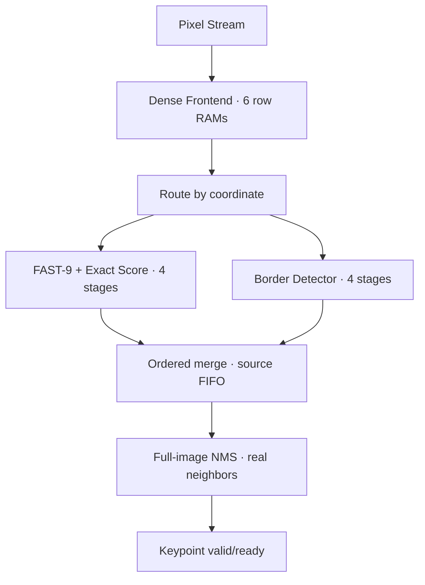

# ORB Detector V2 — FAST interior + directional border

## Phân tích V1 và dataflow

V1: Pixel Stream → sáu RAM hàng → cửa sổ 7×7 → FAST-9 (1 tầng) → exact score
(3 tầng) → hai RAM score → NMS 3×3 → keypoint. Window chỉ valid khi cột/hàng
đầu vào >=6, nên tâm bắt đầu (3,3). NMS chỉ có hàng xóm đầy đủ từ tâm (4,4).
Không có packet nào đại diện (0,0); đặt detector sau window cũ không sửa được.

V1 được giữ nguyên. Các lõi FAST-9, exact score, comparator math và RAM hàng
được tái sử dụng. Thiết kế V2 giữ minimum legal size 7×7: đơn giản hóa flush,
đảm bảo mẫu 3×3 một phía luôn tồn tại và giữ miền cấu hình V1.

## Criterion border và normalization

Lightweight Directional Border Detector là phần mở rộng riêng của project,
không phải FAST/ORB chuẩn. Mẫu Q là 3×3 pixel thật. Với trục gần mép trái/trên,
lấy offsets (0,1,2); gần mép phải/dưới lấy (0,-1,-2); trục không gần mép lấy
(-1,0,1). Top/bottom chỉ hướng trục y vào trong, left/right hướng x vào trong;
bốn góc hướng cả hai trục vào trong. Không lấy pixel ngoài ảnh.

Trên mỗi trong bốn ô 2×2 của Q (A B; C D), tính:

```
gx = (B-A)+(D-C)
gy = (C-A)+(D-B)
h = max(abs(gx)-abs(gy), 0)
v = max(abs(gy)-abs(gx), 0)
H = max(h của bốn ô)
V = max(v của bốn ô)
border_margin = floor(min(H,V)/2)
corner = border_margin > cfg_threshold
normalized_score = corner ? border_margin-1 : 0
```

Flat: gx=gy=0. Straight horizontal/vertical edge chỉ mạnh một hướng nên min=0.
Ideal diagonal ±45° có abs(gx)=abs(gy) ở các ô thay đổi nên cũng cho 0.
L corner có một ô ưu thế ngang và một ô ưu thế dọc nên cả H,V lớn.
Đây là criterion hướng gradient cục bộ; không bảo đảm bất biến theo mọi góc,
không tương đương eigenvalue Harris và có thể bỏ qua isolated border point.

gx/gy là tổng hai hiệu intensity, trong [-510,510]. Chia 2 bằng dịch bit đưa
margin về intensity 0..255. Không có coefficient tùy ý hay clamp làm giả
normalization. Margin-1 đưa score về 0..254, cùng ngữ nghĩa ngưỡng nghiêm ngặt
như FAST. Hai detector có đáp ứng hình học khác nhau, không mathematically
identical. Calibration đã được chạy trước RTL; kết quả được trình bày bên dưới.

Chi phí cấu trúc dự kiến (không phải báo cáo synthesis): 16 hiệu pixel signed 9 bit, 8 tổng signed 10 bit, 8 abs,
8 subtract/comparator cho dominance, 6 max comparator, 1 min comparator,
1 threshold comparator và phép trừ 1; không multiplier/divider tổng quát.
Synthesis có thể chia sẻ hoặc tối ưu logic; không suy ra LE/M4K/Fmax từ số này.

## Frontend, merge và flush

Giữ sáu RAM hàng. Frontend mới phát cửa sổ có tâm toàn ảnh, nhưng vị trí ngoài
ảnh trong container không có ý nghĩa pixel. FAST chỉ nhận tâm có đủ vòng tròn;
border chỉ chọn chín tap thật, không sử dụng các vị trí thiếu.

Lịch sử cột phát center x=0 khi cột thật x=3 đã tới. Cuối mỗi hàng lưu một
snapshot cửa sổ để phát ba tâm phải cuối cùng đồng thời thu ba cột đầu hàng
kế tiếp. Không chèn stall hay extra cycle giữa các hàng khi downstream ready.
Cuối ảnh frontend tự tiến ba hàng alignment nội bộ và ba bước right-tail;
không yêu cầu nguồn gửi fake pixel. Các bước ngoài ảnh chỉ dịch trạng thái,
không được dùng làm số đo detector. Flush frontend: 3*width+3 bước cộng drain.

FAST interior và Border có cùng độ sâu đường dữ liệu 4 tầng. FIFO source nhỏ
ghi route mỗi packet; merge chỉ lấy packet của detector tương ứng đầu FIFO,
giữ đúng thứ tự toàn ảnh dù hai nhánh có bubble hoặc bị chặn.

NMS V2 nhận x=0..W-1, y=0..H-1. Hai RAM score đủ W ô; so sánh chỉ neighbor
thật, vẫn strict >, không tie-break mới. Dùng snapshot right-tail tương tự
(một cột), và tự flush một hàng bottom cùng một bước right-tail. Missing
neighbor được bỏ qua bằng điều kiện tọa độ, không coi score 0 là neighbor thật.
Flush NMS: width+1 bước cộng drain.

busy/done chờ frontend, source FIFO, hai nhánh detector, NMS flush và
keypoint cuối. Nhận một pixel mỗi chu kỳ khi không stall đã được kiểm tra
bằng testbench; timing chưa được Quartus xác nhận.


## Kiến trúc RTL đã triển khai



FAST nhận packet chỉ khi `3<=x<=W-4 && 3<=y<=H-4`. Border nhận phần bù của miền
này. Sáu byte-identical module giữ nguyên: `orb_fast9`, `orb_fast_score`,
`orb_score_math`, `orb_line_buffer`, `orb_row_ram`, `orb_nms_row_ram`.
Module top `orb_detector_frontend` được thay ở V2, giữ nguyên port list V1.
Các frontend/window/NMS cũ không nằm trên đường V2; bản gốc và test gốc nằm trong
`regression/v1/` để chạy lại, không sửa thư mục V1 gốc.

| Module mới | Chức năng |
|---|---|
| `orb_dense_frontend.v` | Raster nguồn thật, sáu row RAM và ba hàng flush alignment |
| `orb_dense_window.v` | Tâm toàn ảnh, snapshot để phát ba tâm phải cuối hàng |
| `orb_border_math.v` | Bốn gradient cell và max tree, không nhân/chia tổng quát |
| `orb_border_detector.v` | Chọn chín tap thật; pipeline bốn tầng tính dominance/margin/score |
| `orb_hybrid_detector.v` | Fork theo vùng, FIFO tám source bit, merge đúng thứ tự |
| `orb_nms3x3_v2.v` | Dense NMS x=0..W-1, y=0..H-1, bottom/right flush tự động |

`map_source=0` là FAST, `map_source=1` là Border; chỉ dùng nội bộ để debug/test.
Mỗi ảnh có chính xác W*H dense packet. Non-corner vẫn có packet, corner=0,
score=0. Border margin hợp lệ 0..255; score corner 0..254. Corner với score 0
vẫn giữ cờ riêng, nhưng có thể bị NMS suppress bởi neighbor có score 0 bằng nó.
FAST raw/exact score giữ byte-identical và không thêm gain hay scale.

## Calibration đã thực hiện

Chạy `python sim/calibrate.py`. Kết quả nằm trong `sim/calibration/`:
`REPORT.md`, `results.json`, `placement_results.json`, `straight_angle_results.json`.
Đã thử 11 pattern, contrast 1,5,10,20,21,40,80,120,200,255, noise 0 hoặc ±2,
paired interior và bốn edge/bốn corner. Với các L/bright/dark corner nhìn thấy
được trong patch, clean FAST score và Border score đều C-1 ở mọi contrast/vị trí
được thử. Vì vậy không thêm coefficient fit; normalization dùng hệ số intensity
1 sau phép chia 2 có cơ sở cấu trúc gradient.

Không ép các pattern checker/isolated point có cùng đáp ứng. Checker có thể được
Border nhận trong khi FAST-9 không nhận; isolated point có thể được FAST nhận
trong khi Border bỏ. Các phân bố noise được ghi range/mean; đây là validation
synthetic, chưa là hiệu chuẩn trên ảnh tự nhiên. Thử thêm 36 single-edge angles
0..175° cách 5°, contrast 180, threshold 20: không có border candidate trong các
ảnh lý tưởng này. Không suy rộng thành đảm bảo false-positive=0 trên mọi ảnh.

## NMS boundary semantics và frame flush

V2 không đặt missing neighbor bằng 0 để so sánh. Mỗi so sánh được enable theo
x/y thật. Tại (0,0), chỉ (1,0),(0,1),(1,1) tham gia; tại cạnh có năm neighbor,
interior có tám. Cờ corner ở tâm phải true và score phải lớn hơn TẤT CẢ neighbor
thật. Hai điểm bằng score cạnh nhau vẫn bị loại; không thêm tie-break.

Các vị trí không tồn tại trong window container chỉ là slot alignment vô nghĩa.
Chúng có thể chứa 0 hoặc dữ liệu RAM cũ: FAST không nhận tâm thiếu vòng tròn,
Border không chọn slot này, NMS không so sánh slot thiếu. Testbench dùng bytes
ngẫu nhiên/0xA7 ở slot thiếu để xác nhận không ảnh hưởng score. Đây không phải
zero-padding ảnh rồi chạy FAST. RAM address luôn 0..W-1, kể cả alignment flush;
không phát một địa chỉ x/y ngoài ảnh để đọc bộ nhớ frame.

Right-tail không tạo thêm chu kỳ ở giữa các hàng: snapshot của hàng trước được
xử lý song song với ba cột đầu hàng mới (frontend), hoặc một cột đầu (NMS).
Sau pixel cuối, frontend tự tiến 3W alignment steps rồi ba tail steps; NMS sau
packet cuối tự tiến W alignment steps rồi một tail step. Slot dummy này không
phải sample detector. Flush là hữu hạn nếu downstream tiếp tục ready; stall có
thể kéo dài wall-clock thời gian, tất cả trạng thái vẫn giữ đúng.

`done` top chờ frontend done, FIFO/source branches rỗng, NMS done và NMS rỗng.
Không assert done khi keypoint_valid=1 và keypoint_ready=0. Reset hủy tầng đang
xử lý; mỗi lần start làm mới counter/valid/history, không reset toàn bộ RAM.

## Latency, throughput và tài nguyên kiến trúc

Không stall: nhận một pixel nguồn thật mỗi clock, đã kiểm tra liên tục ở ảnh
640×480. First dense container center (0,0) được tạo sau khi pixel (3,3) tới và
qua thanh ghi cột/window. Mỗi nhánh detector có bốn tầng registered. NMS chờ
neighbor thật (1,1) để quyết định tâm (0,0), sau đó đăng ký keypoint. Các tầng
đều có ready/valid; khi blocked dữ liệu/valid/tọa độ/score/route giữ ổn định.
Không coi latency theo thời gian là cố định khi có gap/stall.

Ở bài 640×480 không stall, testbench quan sát từ setup start đến done:
309.776 chu kỳ, trong đó inputspan=307.200 chu kỳ cho 307.200 pixel. Nếu clock
thật đạt 50 MHz, interval đó tương ứng 6,19552 ms. Đây là RTL simulation cho
khối detector, chưa bao gồm tạo pyramid, SDRAM, descriptor hoặc toàn SoC.

| Thành phần | V1 | V2 |
|---|---|---|
| Pixel line RAM | 6W×8 bit | Giữ nguyên 6W×8 bit |
| Window history/output | 42+49 byte | Giữ tương đương, thêm snapshot tail 49 byte |
| Border frame RAM | Không | Không thêm frame RAM; dùng chín tap của container |
| NMS RAM | 2(W-6)×9 bit | 2W×9 bit |
| NMS right-tail | Không | Snapshot ba hàng × ba ô × 9 bit = 81 bit |
| Border arithmetic | Không | 16 diff, 8 sum, 8 abs, dominance/max/min và threshold |
| Route buffering | Không | Tám source bit + counter/control |
| Multiplier/divider | Không trên detector này | Không thêm; normalization dùng bit shift |
| Extra frame flush | Drain pipeline | Frontend 3W+3; NMS W+1, cộng registered drain |

Tại W=640, pixel RAM có 30.720 bit dữ liệu; NMS RAM tăng từ 11.412 lên 11.520 bit.
Đây là số bit logical, không phải số M4K chính xác. Không có kết quả LE/M4K/Fmax
vì chưa tổng hợp/fitting Quartus. Ready fan-out, gradient cell combinational
path, source mux và OLD DATA inference cần kiểm tra trên công cụ thật.

## Chạy và kiểm chứng

Source/reference/vector/log đều kèm theo. Trong môi trường có Icarus và NumPy:

```bash
cd orb_fast_nms_v2/sim
bash run_all.sh
```

Script chạy source fingerprints/style check, calibration, vector generation,
TOÀN BỘ test suite V1 trong snapshot, rồi Border, Hybrid, NMS V2 và end-to-end
V1/V2 comparison. Nó kiểm tra marker và FAIL, không chỉ exit code.

Trong ModelSim-ASE, chuyển vào thư mục `sim`, chạy:

```tcl
do run_modelsim.do
```

Script tạo hai work libraries riêng, chạy original V1 fixtures từ snapshot và
các test V2. Nó kiểm tra completion counters trong hierarchy sau mỗi run để
không coi `$finish` khi FAIL là pass. Script ModelSim được cung cấp nhưng chưa
được thực thi tại đây. Python calibration được chạy riêng nếu dùng ModelSim.
Các completion counts trong .do khớp fixture kèm theo; cập nhật nếu thay vectors.
Để xem waveform sau suite, có thể `vsim v2_work.tb_detector_v2` và add signals
của `dut/map_*`, pixel/keypoint handshake, busy/done trước `run -all`.

Kết quả đã thực thi: Icarus Verilog 11.0, `-g2001 -Wall`:

- Toàn bộ V1 suite pass, bao gồm 1.551 FAST/score case và ba kích thước pyramid.
- 1.080 Border directed/random/threshold/angle case pass; invalid slots poisoned.
- Hybrid pass chín forced stalls tại border, x=2/3, y transition, right/bottom và
  packet cuối; xác nhận FAST không nhận Border và ngược lại.
- NMS V2 pass maxima tại bốn góc, bốn edge, interior, cross-border candidates,
  equal plateau và random dense map, có stall packet cuối.
- 16 ảnh end-to-end pass: flat, horizontal/vertical/diagonal edge, L corner,
  checker, isolated bright/dark, random threshold 0/20/255, các tầng thực.
- Reset giữa frame, nhiều level liên tiếp, random source gaps và consumer stalls
  pass; từng dense packet và source bit so với behavioral reference.
- Actual V1 và V2 được mô phỏng trên cùng từng ảnh bằng source drivers độc lập.
  Tất cả FAST score của V1 được đối chiếu; mọi keypoint V2 trong miền
  x=4..W-5, y=4..H-5 bằng V1 vì NMS neighborhood đều là FAST trong miền này.
- Ảnh 9×9 có bốn khối 2×2 sáng ở góc: V1 có 0 keypoint; V2 có (0,0),(8,0),
  (0,8),(8,8), mỗi điểm score 179. Không sinh một loạt corner trên straight edges.
- 640×480: V1 540 keypoint, V2 544; 320×240: 130→134; 160×120: 35→39 trong
  các ảnh sparse/corner tổng hợp được thử. Các số này không là benchmark ảnh thật.

Log đầy đủ nằm ở `sim/results/`. Marker cuối có ALL FAST REGRESSION / BORDER /
SCORE NORMALIZATION / NMS V2 / STREAMING / DETECTOR V2 TESTS PASSED.
`v1_fingerprint.json` ghi hash trước thay đổi; original V1 được kiểm tra còn nguyên.

## Quartus và giới hạn

Chọn top `orb_detector_frontend`, thêm chỉ `rtl/*.v`, không thêm regression/test
files vào synthesis. `constraints/frontend.sdc` có clock 20 ns; I/O/pin/bus timing
cần bổ sung tại top SoC. Sáu RAM pixel và hai RAM score là synchronous OLD DATA,
không reset cả array. Kiểm tra Inferred RAMs, read-during-write, M4K packing,
LE/register usage và timing sau fitting ở Cyclone II. Chưa có Quartus 13.0sp1
trong môi trường này, nên chưa xác nhận synthesis/timing/50 MHz.

Minimum vẫn 7×7. Border criterion không có invariance góc/scale như thuật toán
corner đầy đủ; neighborhood một phía có thể lệch vị trí đến hai pixel, nhạy
noise/texture và bỏ isolated border point. Score được chuẩn hóa đơn vị intensity,
không bảo đảm phân bố/ý nghĩa thống kê giống FAST trên mọi ảnh. Đây là extension
riêng, không mô tả là ORB chuẩn. Keypoint sát biên cần chính sách patch riêng ở
Orientation/rBRIEF tương lai; hỗ trợ detection tại biên không tự giải quyết patch
31×31 của descriptor. Chưa đánh giá matching accuracy trên ảnh tự nhiên hay
60 FPS toàn hệ thống.
